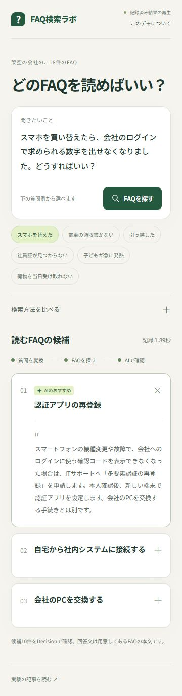

# FAQ検索ラボ

架空の社内FAQ18件と質問例6件を使った、前回・今回の記事共通の検索アプリの説明用デモです。質問例を選び、候補3件を表示し、開いて既存のFAQ回答を読めます。

「検索方法を比べる」で、検索のみ・検索＋Flash・検索＋Decisionを切り替えられます。通常の利用画面からモデルの設定を分離しています。



## 記録済み結果の再生

検索順位は実際のAPI呼び出しで収録したものです。FAQの質問文をgemini-embedding-2（768次元）で索引化し、各質問の候補10件に対してGemini 3.8 FlashとGemini Decision 1を呼び出しました。順位をデモの見栄えのために入れ替えていません。

各質問のベクトル化は1回記録し、候補のローカル検索と各リランクの時間を合算して再生しています。各方式をアプリ上で連続測定した応答時間ではありません。初回を含め、記録を速度の見栄えのために選別していません。画面の再生ではAPIを呼ばず、課金も発生しません。

自由入力は受け付けず、質問例を選ぶ方式です。FAQ本文と問い合わせは本デモ用に新規作成した架空の内容であり、第三者のFAQを転載したものではありません。記事のLocalgovFAQ 1,786件・問い合わせ587問とは別データで、ここから性能の優劣を結論づけません。

## ローカル実行

リポジトリーのルートから:

```bash
python scripts/build_faq_demo.py
python -m http.server 8765 --directory demo/faq-search/dist
```

[ローカルデモ](http://localhost:8765/)を開きます。外部ライブラリ・外部フォント・APIキーは不要です。

## CodePenへ持ち込む

デモの「このデモについて」→「CodePenで開く」を使うと、[公式Prefill API](https://blog.codepen.io/documentation/prefill/)へHTML・CSS・データ込みのJavaScriptをPOSTし、新しいPenの編集画面を開きます。外部アセットやAPIキーは含めません。

転送後の実行画面まで確認済みです。保存・公開にはCodePenへのログインが必要で、この時点ではPenの公開URLはまだ作っていません。転送されるコードはdist/codepen.jsonでも確認できます。手動の場合は、そのhtml・css・jsを各エディターへ貼り付けます。

Sitesの[本人向けプレビュー](https://faq-search-lab-ja-1114.takatama.chatgpt.site)にも配信しています。ChatGPTでのログインが必要です。記事の読者向けの埋め込み先には、保存・公開後のCodePen URLを使ってください。

## 検証

```bash
python scripts/build_faq_demo.py
python scripts/verify_faq_demo.py
```

保存データのID・順位・確率・使用量・費用と、CodePen出力の完全性をオフラインで検証します。ブラウザでは6問×3方式の再生、FAQのキーボード開閉、再生途中の質問変更による古い処理のキャンセル、1280×900と390×844での表示と横はみ出しを確認しました。CodePenの匿名エディター内でもプレビューの初期表示を確認しています。

## 再収録

既存の環境を使う場合:

```bash
OPENBLAS_NUM_THREADS=1 PYTHONPATH=work/decisions-sdk \
  .venv/bin/python scripts/record_faq_demo.py
python scripts/build_faq_demo.py
```

GEMINI_API_KEYとgoogle-genai 3.3.0、numpyが必要です。キーをソースやCodePenに入れないでください。再収録のAPI呼び出しには通常の利用料金がかかります。完了したサンプルはwork/faq-demo-recordings/の進捗から再利用し、入力データのfingerprintが変わると再開しません。

## 記事での紹介

[両記事向けの紹介文](../../docs/faq-demo-introduction.md)を用意しています。原稿では、画面の使い方と記録再生であることを冒頭で説明し、ベンチマークの測定値と分けます。
